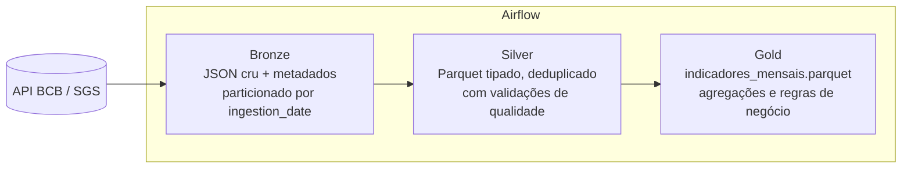

# BCB Medallion Pipeline: Brazilian Economic Indicators

Pipeline de dados com **arquitetura medalhão (Bronze → Silver → Gold)**, orquestrado com **Apache Airflow**, que consome a API pública do **Banco Central do Brasil (SGS)** e entrega uma tabela analítica mensal com dólar, Selic e IPCA.

   

## Arquitetura



| Camada | O que faz | Formato | Arquivo |
|---|---|---|---|
| **Bronze** | Guarda o dado exatamente como veio da API, com metadados (origem, data/hora, nº de registros) | JSON | `src/pipeline/bronze.py` |
| **Silver** | Converte tipos, remove duplicatas e inválidos, valida qualidade | Parquet | `src/pipeline/silver.py` |
| **Gold** | Agrega por mês, calcula variação do dólar e IPCA acumulado em 12 meses (SQL/DuckDB) | Parquet | `src/pipeline/gold.py` |

## Decisões técnicas

- **Bronze imutável e particionada por data**: permite reprocessar tudo sem chamar a API de novo e auditar o que foi recebido.
- **`transform()` é função pura**: testável sem rede, sem disco e sem Airflow.
- **Falha cedo**: validações de qualidade na Silver impedem que dado ruim chegue na Gold.
- **Idempotência**: reexecutar no mesmo dia sobrescreve a mesma partição, sem duplicar.
- **Dynamic Task Mapping** no Airflow: uma task por série, em paralelo, com retry independente.
- **DuckDB + Parquet**: analytics colunar sem servidor, ótimo para desenvolvimento local.

## Como rodar

**Sem Airflow (mais rápido para testar):**
```bash
make install
source .venv/bin/activate
make run        # roda bronze -> silver -> gold
make test
```

**Com Airflow (Docker):**
```bash
make up         # sobe em http://localhost:8080
docker compose logs airflow | grep -i password   # senha do usuário admin
```
Ative a DAG `medallion_bcb` e dispare manualmente (▶).

## Consultando a Gold

```python
import duckdb
duckdb.sql("SELECT * FROM 'data/gold/indicadores_mensais.parquet' ORDER BY mes DESC LIMIT 12").show()
```

## Estrutura

```
├── dags/medallion_bcb_dag.py   # orquestração
├── src/pipeline/               # bronze, silver, gold, config, CLI
├── tests/                      # pytest (Silver e Gold)
├── .github/workflows/ci.yml    # lint + testes a cada push
└── docker-compose.yml          # Airflow local
```

## Próximos passos (roadmap)

- [ ] Migrar a Gold para **dbt-duckdb** (modelos, testes e documentação)
- [ ] Testes de qualidade com **Great Expectations** ou **Soda**
- [ ] Storage em **S3/MinIO** + formato **Delta Lake / Iceberg**
- [ ] Dashboard em **Metabase** ou **Streamlit** sobre a Gold
- [ ] Alertas de falha (Slack/e-mail) via callbacks do Airflow

## Fonte dos dados
[Banco Central do Brasil - SGS](https://dadosabertos.bcb.gov.br): séries 1 (dólar venda), 432 (meta Selic) e 433 (IPCA).
