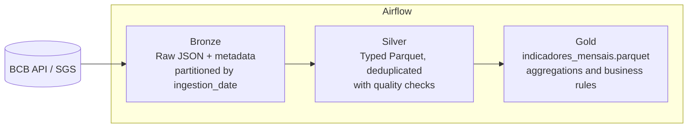

🇧🇷 [Leia em português](README.pt-BR.md)

# BCB Medallion Pipeline: Brazilian Economic Indicators

ETL/ELT pipeline with **Medallion Architecture** (Bronze → Silver → Gold), orchestrated by **Apache Airflow**, using open data from the Brazilian Central Bank (BCB/SGS): USD/BRL exchange rate, Selic target rate and IPCA inflation. It delivers a monthly analytical table.


## About this project

This is a learning project in data engineering. I set up the whole environment from scratch (WSL2, Docker, VS Code), ran each layer one at a time, debugged the problems that came up (typos in commands, Docker volume permissions, linter errors), and validated the results with tests, lint, queries on the Gold table and a full DAG run in Airflow.

## Architecture



| Layer | What it does | Format | File |
|---|---|---|---|
| **Bronze** | Stores the data exactly as received from the API, plus metadata (source, timestamp, record count) | JSON | `src/pipeline/bronze.py` |
| **Silver** | Converts types, removes duplicates and invalid rows, validates quality | Parquet | `src/pipeline/silver.py` |
| **Gold** | Aggregates by month, computes USD monthly change and 12-month cumulative IPCA (SQL/DuckDB) | Parquet | `src/pipeline/gold.py` |

## Data sources

| Series | SGS code | Frequency |
|---|---|---|
| USD/BRL exchange rate (sell) | 1 | Daily (business days) |
| Selic target rate (% p.a.) | 432 | Daily |
| IPCA monthly change (%) | 433 | Monthly |

Source: [Banco Central do Brasil open data](https://dadosabertos.bcb.gov.br).

## Output: Gold table

`data/gold/indicadores_mensais.parquet`, one row per month:

| Column | Description |
|---|---|
| `mes` | First day of the month |
| `dolar_medio` | Average USD/BRL quote in the month |
| `dolar_var_mensal` | Change vs. previous month (`0.0231` = +2.31%) |
| `selic_meta_fim_mes` | Selic target at the end of the month (% p.a.) |
| `ipca_mensal` | Monthly IPCA (%) |
| `ipca_acum_12m` | Cumulative IPCA over 12 months (null until 12 months of data exist) |

## Technical decisions

- **Bronze keeps the raw data, partitioned by ingestion date** (`ingestion_date=YYYY-MM-DD`): it gives history, allows auditing, and lets us reprocess without calling the API again.
- **`transform()` is a pure function**: a list goes in, a DataFrame comes out, with no network or disk access. That makes it easy to test.
- **Fail early**: quality checks in Silver stop the pipeline before bad data reaches Gold.
- **Idempotency**: running twice on the same day overwrites the same partition instead of duplicating data.
- **Dynamic Task Mapping** in Airflow: one task per series, each with its own retries. If one series fails, the others do not need to rerun.
- **DuckDB + Parquet**: columnar analytics locally, with no database server.

## How to run

**Requirements:** Python 3.11+ and `make`. Docker is only needed for Airflow. On Windows, use WSL2 (the `Makefile` assumes Linux).

**Without Airflow** (fastest way to try it):

```bash
make install
make run     # bronze -> silver -> gold
make test
make lint
```

**With Airflow (Docker):**

```bash
make up      # starts Airflow at http://localhost:8080
docker compose exec airflow cat /opt/airflow/standalone_admin_password.txt
```

Log in with user `admin` and the password above, enable the `medallion_bcb` DAG and trigger it. To stop everything: `make down`.

**Troubleshooting:** if `make up` fails with `Permission denied` on the `data/` folder, the Airflow container created files owned by another user. Fix it with:

```bash
sudo chown -R $USER:$USER data
```

## Querying the Gold layer

```bash
python - <<'EOF'
import duckdb
print(duckdb.sql("SELECT * FROM 'data/gold/indicadores_mensais.parquet' ORDER BY mes DESC LIMIT 12").df().to_string())
EOF
```

## Project structure

```
├── dags/medallion_bcb_dag.py   # orchestration
├── src/pipeline/               # bronze, silver, gold, config, CLI
├── tests/                      # pytest (Silver and Gold)
├── docs/COMMITS.md             # suggested commit roadmap
├── .github/workflows/ci.yml    # lint + tests on every push
├── docker-compose.yml          # local Airflow
├── README.md                   # English
└── README.pt-BR.md             # Portuguese
```

## Known limitations

- Bronze downloads the **full history** on every run (full load, not incremental).
- Silver is fully rewritten on every run.
- The current month is incomplete: the USD average covers only the days so far, and IPCA is not published yet (shown as null).
- Airflow runs in standalone mode (SQLite + SequentialExecutor), meant for development, so tasks run one at a time. Production would need Postgres and another executor.
- The `data` column in Silver is stored as a timestamp (with `00:00:00`) instead of a pure date.
- Code comments and docstrings are in Portuguese.
