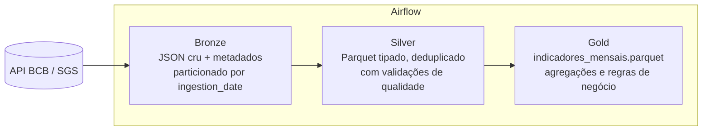

🇺🇸 [Read in English](README.md)

# Pipeline Medalhão: Indicadores Econômicos do Brasil

Pipeline ETL/ELT com **arquitetura medalhão** (Bronze → Silver → Gold), orquestrado com **Apache Airflow**, que usa dados abertos do Banco Central do Brasil (BCB/SGS): cotação do dólar, meta Selic e inflação (IPCA). Entrega uma tabela analítica mensal.


## Sobre este projeto

Este é um projeto de estudo em engenharia de dados. Eu montei todo o ambiente do zero (WSL2, Docker, VS Code), executei cada camada separadamente, depurei os problemas que apareceram (erros de digitação em comandos, permissões de volume do Docker, erros do linter) e validei os resultados com testes, lint, consultas na tabela Gold e uma execução completa da DAG no Airflow.

## Arquitetura



| Camada | O que faz | Formato | Arquivo |
|---|---|---|---|
| **Bronze** | Guarda o dado exatamente como veio da API, com metadados (origem, data/hora, nº de registros) | JSON | `src/pipeline/bronze.py` |
| **Silver** | Converte tipos, remove duplicatas e inválidos, valida qualidade | Parquet | `src/pipeline/silver.py` |
| **Gold** | Agrega por mês, calcula a variação mensal do dólar e o IPCA acumulado em 12 meses (SQL/DuckDB) | Parquet | `src/pipeline/gold.py` |

## Fontes de dados

| Série | Código SGS | Frequência |
|---|---|---|
| Dólar americano (venda) | 1 | Diária (dias úteis) |
| Meta Selic (% a.a.) | 432 | Diária |
| IPCA, variação mensal (%) | 433 | Mensal |

Fonte: [Dados Abertos do Banco Central do Brasil](https://dadosabertos.bcb.gov.br).

## Resultado: tabela Gold

`data/gold/indicadores_mensais.parquet`, uma linha por mês:

| Coluna | Descrição |
|---|---|
| `mes` | Primeiro dia do mês |
| `dolar_medio` | Média das cotações do dólar no mês |
| `dolar_var_mensal` | Variação em relação ao mês anterior (`0.0231` = +2,31%) |
| `selic_meta_fim_mes` | Meta Selic no fim do mês (% a.a.) |
| `ipca_mensal` | IPCA do mês (%) |
| `ipca_acum_12m` | IPCA acumulado em 12 meses (nulo até haver 12 meses de dados) |

## Decisões técnicas

- **A Bronze preserva o dado cru, particionado por data de ingestão** (`ingestion_date=AAAA-MM-DD`): dá histórico, permite auditar o que foi recebido e reprocessar sem chamar a API de novo.
- **`transform()` é uma função pura**: entra uma lista e sai um DataFrame, sem acesso a rede ou disco. Isso facilita os testes.
- **Falhar cedo**: as validações da Silver interrompem o pipeline antes que dado ruim chegue à Gold.
- **Idempotência**: rodar duas vezes no mesmo dia sobrescreve a mesma partição, sem duplicar dados.
- **Dynamic Task Mapping** no Airflow: uma task por série, cada uma com seus próprios retries. Se uma série falhar, as outras não precisam rodar de novo.
- **DuckDB + Parquet**: análise colunar local, sem servidor de banco de dados.

## Como rodar

**Requisitos:** Python 3.11+ e `make`. O Docker só é necessário para o Airflow. No Windows, use o WSL2 (o `Makefile` pressupõe Linux).

**Sem Airflow** (jeito mais rápido de testar):

```bash
make install
make run     # bronze -> silver -> gold
make test
make lint
```

**Com Airflow (Docker):**

```bash
make up      # sobe o Airflow em http://localhost:8080
docker compose exec airflow cat /opt/airflow/standalone_admin_password.txt
```

Entre com o usuário `admin` e a senha acima, ative a DAG `medallion_bcb` e dispare-a. Para encerrar: `make down`.

**Problemas comuns:** se o `make
